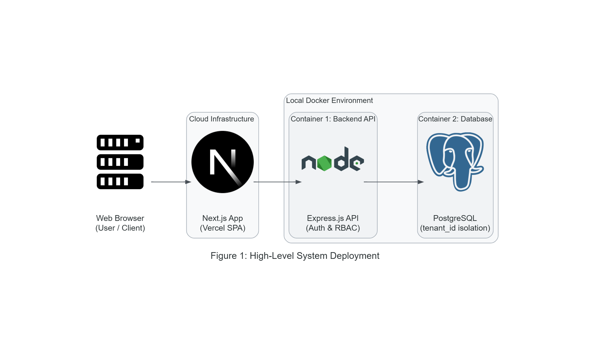

# System Architecture & Technical Design Document
## Project: TenantFlow (Enterprise Multi-Tenant Saas)

## 1.  High-Level Architecture Overview
TenantFlow menggunakan arsitektur monolitik modular modern yang memisahkan lapisan *Frontend* dan *Backend*, didukung oleh basis data relasional terpusat dengan isolasi logis berbasis *Tenant ID*. Alur operasional sistem berjalan secara hierarkis: pengguna pertama mendaftarkan organisasi sebagai Tenant Owner, yang kemudian dapat melakukan provisioning akun Project Manager (PM) di dalam workspace tersebut. Selanjutnya, PM dapat mengelola proyek dan menugaskan akun Member (Staff) ke dalam proyek spesifik. Seluruh permintaan (requests) dari frontend akan diproses oleh Express.js (Backend REST API) yang menangani autentikasi JWT dan validasi Role-Based Access Control (RBAC). Data kemudian disimpan ke PostgreSQL, di mana setiap tabel operasional diwajibkan memiliki kolom `tenant_id` untuk memastikan isolasi data antar-perusahaan terjaga secara ketat.

*   **Frontend Layer:** Next.js (App Router). Bertindak sebagai Single Page Application (SPA).
*   **Backend Layer:** Node.js (Express.js) / REST API yang menangani logika bisnis, autentikasi JWT, dan validasi *Role-Based Access Control (RBAC)*.
*   **Database Layer:** PostgreSQL yang mengandalkan kolom `tenant_id` pada setiap tabel relasional untuk memastikan keamanan isolasi data antar perusahaan.
*   **Containerization:** Docker & Docker Compose untuk menyeragamkan lingkungan pengembangan lokal (*Local Development Environment*).

---
