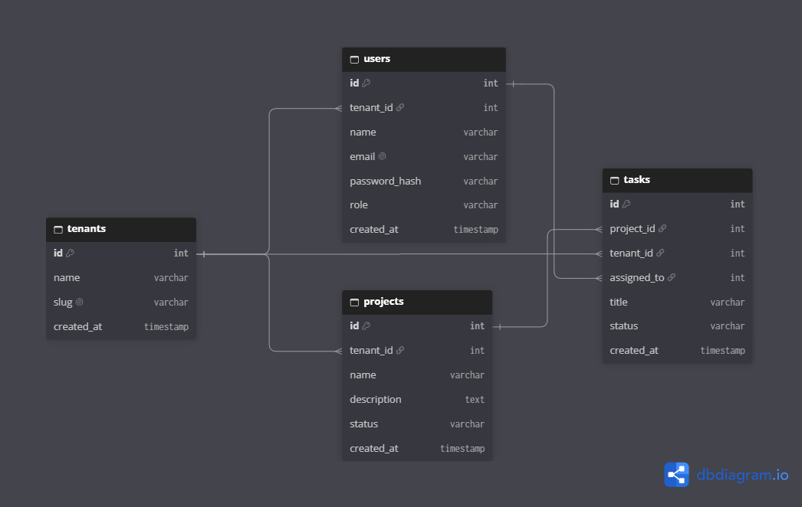
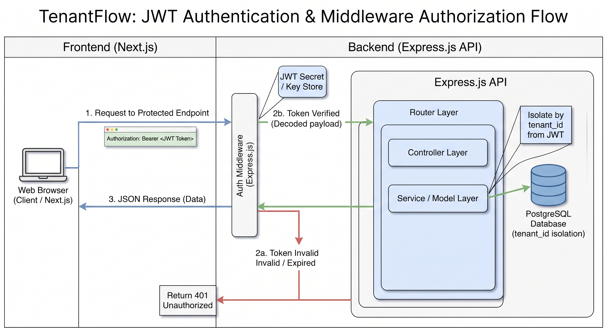
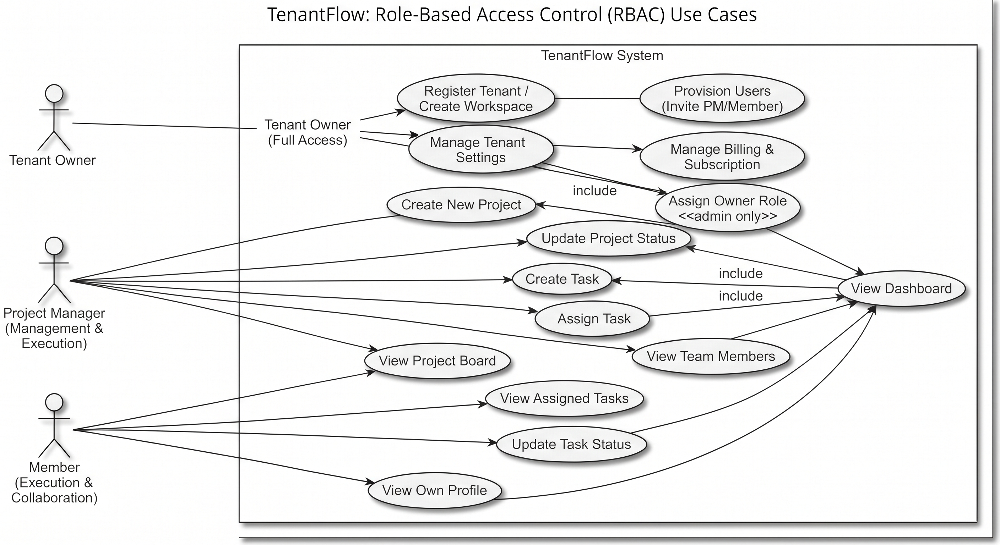

# System Architecture & Technical Design Document
## Project: TenantFlow (Enterprise Multi-Tenant Saas)

## 1.  High-Level Architecture Overview
TenantFlow menggunakan arsitektur monolitik modular modern yang memisahkan lapisan *Frontend* dan *Backend*, didukung oleh basis data relasional terpusat dengan isolasi logis berbasis *Tenant ID*. 

Alur operasional sistem berjalan secara hierarkis: pengguna pertama mendaftarkan organisasi sebagai Tenant Owner, yang kemudian dapat melakukan provisioning akun Project Manager (PM) di dalam workspace tersebut. Selanjutnya, PM dapat mengelola proyek dan menugaskan akun Member (Staff) ke dalam proyek spesifik. Seluruh permintaan (requests) dari frontend akan diproses oleh Express.js (Backend REST API) yang menangani autentikasi JWT dan validasi Role-Based Access Control (RBAC). Data kemudian disimpan ke PostgreSQL, di mana setiap tabel operasional diwajibkan memiliki kolom `tenant_id` untuk memastikan isolasi data antar-perusahaan terjaga secara ketat.


*   **Frontend Layer:** Next.js (App Router). Bertindak sebagai Single Page Application (SPA).
*   **Backend Layer:** Node.js (Express.js) / REST API yang menangani logika bisnis, autentikasi JWT, dan validasi *Role-Based Access Control (RBAC)*.
*   **Database Layer:** PostgreSQL yang mengandalkan kolom `tenant_id` pada setiap tabel relasional untuk memastikan keamanan isolasi data antar perusahaan.
*   **Containerization:** Docker & Docker Compose untuk menyeragamkan lingkungan pengembangan lokal (*Local Development Environment*).

---

## 2. Database Schema & Entity Relationship Diagram (ERD)

Basis data **TenantFlow** dirancang menggunakan pendekatan relasional terpusat dengan PostgreSQL untuk memastikan integritas data, konsistensi transaksi (*ACID compliance*), serta isolasi logis antar-perusahaan (*multi-tenancy*).



1. **`tenants`:**
   * Berfungsi sebagai entitas induk (*parent*) bagi seluruh data operasional perusahaan yang terdaftar di dalam sistem.
   * **Kolom Utama:** `id` (PK), `name`, `slug`, dan `created_at`.
2. **`users`:**
   * Menyimpan informasi akun pengguna yang tergabung dalam suatu *tenant* tertentu, dilengkapi dengan kolom `role` untuk membedakan hak akses (*Owner*, *Project Manager*, *Member*).
   * **Kolom Utama:** `id` (PK), `tenant_id` (FK ke `tenants.id`), `name`, `email`, `password_hash`, `role`, dan `created_at`.
3. **`projects`:**
   * Dikelola oleh *Project Manager* di dalam suatu *tenant* untuk mengelompokkan pekerjaan dan tugas-tugas tim.
   * **Kolom Utama:** `id` (PK), `tenant_id` (FK ke `tenants.id`), `name`, `description`, `status` (*planning*, *in_progress*, *completed*), dan `created_at`.
4. **`tasks`:**
   * Memuat rincian tugas spesifik di dalam suatu proyek yang dapat ditugaskan (*assigned*) kepada anggota tim (*member*).
   * **Kolom Utama:** `id` (PK), `project_id` (FK ke `projects.id`), `tenant_id` (FK ke `tenants.id`), `assigned_to` (FK ke `users.id`), `title`, `status` (*todo*, *in_progress*, *done*), dan `created_at`.

#### **Strategi Keamanan Multi-Tenancy (`tenant_id`):**
Seluruh tabel operasional (`users`, `projects`, dan `tasks`) wajib menyertakan kolom `tenant_id`. Hal ini memastikan bahwa setiap *query* yang dieksekusi oleh backend selalu difilter berdasarkan ID perusahaan yang sedang aktif, sehingga kebocoran data antar-tenant dapat dicegah.


---

## 3. API Endpoints Mapping

Backend **TenantFlow** menyediakan RESTful API endpoints yang dirancang terstruktur untuk mendukung interaksi dari frontend. Seluruh rute (kecuali publik) dilindungi oleh *Auth Middleware* untuk validasi token **JWT** serta pemeriksaan hak akses berbasis peran (*RBAC*).

### **A. Authentication & User Management**
Mengelola otentikasi pengguna, penerbitan token sesi, serta registrasi akun awal.

| Method | Endpoint | Description | Access Role |
| :--- | :--- | :--- | :--- |
| `POST` | `/api/v1/auth/register` | Mendaftarkan *Tenant Owner* baru beserta pembuatan *workspace* perusahaan. | Public |
| `POST` | `/api/v1/auth/login` | Autentikasi kredensial pengguna dan mengembalikan token JWT. | Public |
| `GET` | `/api/v1/auth/me` | Mengambil profil pengguna yang sedang aktif berdasarkan token sesi. | Authenticated |

### **B. Tenant & Workspace Management**
Mengelola data perusahaan dan manajemen anggota tim di dalam workspace.

| Method | Endpoint | Description | Access Role |
| :--- | :--- | :--- | :--- |
| `GET` | `/api/v1/tenants` | Mengambil detail informasi *workspace* tenant yang aktif. | Owner / PM / Member |
| `POST` | `/api/v1/tenants/users` | Menambahkan (*provisioning*) akun baru (PM/Member) ke dalam *tenant*. | Owner / PM |
| `GET` | `/api/v1/tenants/users` | Menampilkan daftar seluruh anggota tim di dalam *tenant*. | Owner / PM / Member |

### **C. Project Management**
Mengelola siklus hidup proyek di dalam organisasi.

| Method | Endpoint | Description | Access Role |
| :--- | :--- | :--- | :--- |
| `GET` | `/api/v1/projects` | Menampilkan daftar seluruh proyek dalam satu *tenant*. | Owner / PM / Member |
| `POST` | `/api/v1/projects` | Membuat proyek baru (*planning*). | Owner / PM |
| `PUT` | `/api/v1/projects/:id` | Memperbarui detail atau status proyek. | Owner / PM |
| `DELETE` | `/api/v1/projects/:id` | Menghapus data proyek dari sistem. | Owner |

### **D. Task Management**
Mengelola rincian tugas operasional di dalam suatu proyek.

| Method | Endpoint | Description | Access Role |
| :--- | :--- | :--- | :--- |
| `GET` | `/api/v1/projects/:projectId/tasks` | Menampilkan daftar tugas dalam proyek tertentu. | Owner / PM / Member |
| `POST` | `/api/v1/projects/:projectId/tasks` | Membuat tugas baru dan menetapkannya ke anggota tim (*assigned_to*). | Owner / PM |
| `PUT` | `/api/v1/tasks/:id` | Memperbarui status tugas (*todo* $\rightarrow$ *in_progress* $\rightarrow$ *done*). | Owner / PM / Member |
| `DELETE` | `/api/v1/tasks/:id` | Menghapus tugas dari proyek. | Owner / PM |


---

## 4. Security & Access Control Strategy

Untuk menjamin keamanan data antar perusahaan (*tenant*) dan integritas tindakan pengguna, **TenantFlow** menerapkan lapisan keamanan ganda di level autentikasi dan otorisasi.



### **A. JSON Web Token (JWT) Authentication**
* **Mekanisme:** Setelah pengguna berhasil melakukan *login* melalui `/api/v1/auth/login`, server Express.js menerbitkan token JWT yang berisi klaim (*claims*) penting seperti `user_id`, `email`, `role`, dan `tenant_id`.
* **Penggunaan:** Setiap kali frontend Next.js mengirimkan *request* ke *protected endpoints*, token tersebut wajib disertakan di dalam header HTTP menggunakan skema *Bearer*:
  ```http
  Authorization: Bearer <jwt_token>
* **Validasi Sesi:** Auth Middleware pada backend akan mendekode dan memverifikasi tanda tangan serta masa berlaku token sebelum request diteruskan ke controller logika bisnis.

### **B. Role-Based Access Control (RBAC)**
Hak akses pengguna di dalam sistem dibagi menjadi tiga hierarki peran utama untuk memastikan pemisahan tugas yang jelas:



1. **Tenant Owner:** 
   * Memiliki hak akses penuh (full privileges) terhadap workspace perusahaan.
   * Dapat mendaftarkan tenant, mem-provisioning akun Project Manager atau Member, serta menghapus proyek.
2. **Project Manager (PM):** 
   * Bertanggung jawab mengelola operasional proyek, perencanaan (*planning*), dan pemantauan *timeline*.
   * Dapat membuat proyek baru dan memperbarui status proyek.
   * Dapat membuat, menetapkan (*assign*), dan mengubah status *task* di dalam proyek.
   * Dapat mengambil bagian dalam eksekusi proyek dengan cara menetapkan task kepada dirinya sendiri atau mengerjakan task yang ada.
3. **Member:**
   * Dapat melihat daftar proyek dalam tenant, melihat rincian tugas yang ditugaskan kepadanya, serta memperbarui status tugas (todo $\rightarrow$ in_progress $\rightarrow$ done).
   * Fokus pada eksekusi tugas harian.
